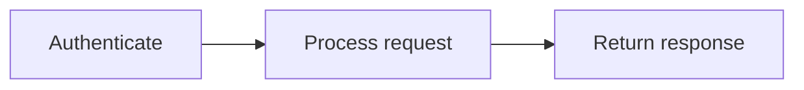

<!-- Original Source: https://github.com/SuperiorByteWorks-LLC/agent-project | License: Apache-2.0 | Author: Clayton Young / Superior Byte Works -->
<!-- Modified: emoji, colour classes and the diagram selection table removed; verification steps changed. -->

# Mermaid Diagram Style Guide

**Target Platform:** GitHub Markdown (Issues, PRs, Discussions, Wikis, `.md` files)
**Design Goal:** Plain, professional diagrams that render in both GitHub light and dark modes, are accessible to screen readers, and carry no decoration.

---

## Quick Start for Agents

1. Pick the diagram type from the table in `SKILL.md`.
2. Open that type's file, copy the template and fill in the content. Leave out the emoji and `classDef` lines that the examples contain.
3. Apply the naming, shape and subgraph rules in this file.
4. Add `accTitle` and `accDescr` (or an italic Markdown paragraph for unsupported types).
5. Run the [Quality Checklist](#quality-checklist) and check the [Known Parser Gotchas](#known-parser-gotchas). When mermaid-cli (`mmdc`) is available, render the diagram to confirm that it parses.

---

## Core Principles

| #   | Principle                           | Rule                                                                                                   |
| --- | ----------------------------------- | ------------------------------------------------------------------------------------------------------ |
| 1   | **Clarity at every scale**          | Simple diagrams stay flat. Complex ones use subgraphs. Very complex ones split into overview + detail. |
| 2   | **Accessibility always**            | Every diagram gets `accTitle` + `accDescr`. No exceptions.                                             |
| 3   | **Theme neutral**                   | No `%%{init}` theme directives. No inline `style`. Let GitHub auto-theme.                              |
| 4   | **Semantic clarity**                | `snake_case` node IDs that match labels. Active voice. Sentence case.                                  |
| 5   | **Consistent shapes**               | Same shape = same meaning everywhere.                                                                  |
| 6   | **No decoration**                   | No emoji and no `classDef` colours. Bold on one key term at most.                                      |

---

## Accessibility Requirements

**Every diagram MUST include both `accTitle` and `accDescr`:**

```
accTitle: Short Name 3-8 Words
accDescr: One or two sentences explaining what this diagram shows and what insight the reader gains from it
```

- `accTitle` — 3–8 words, plain text, names the diagram
- `accDescr` — 1–2 sentences on a **single line** (GitHub limitation), explains purpose and key structure

**Diagram types that do NOT support `accTitle`/`accDescr`:** Mindmap, Timeline, Quadrant, Sankey, XY Chart, Block, Kanban, Packet, Architecture, Radar, Treemap. For these, place a descriptive _italic_ Markdown paragraph directly above the code block as the accessible description.

---

## Theme Configuration

### ✅ Do: No theme directive (GitHub auto-detects)



### ❌ Don't: Inline styles or custom themes

```
%% BAD — breaks dark mode
style A fill:#e8f5e9
%%{init: {'theme':'base'}}%%
```

---

## Node Naming & Labels

| Rule                  | ✅ Good                    | ❌ Bad                              |
| --------------------- | -------------------------- | ----------------------------------- | 
| `snake_case` IDs      | `run_tests`, `deploy_prod` | `A`, `B`, `node1`                   |
| IDs match labels      | `open_pr` → "Open PR"      | `x` → "Open PR"                     |
| Specific names        | `check_unit_tests`         | `check`                             |
| Verbs for actions     | `run_lint`, `deploy_app`   | `linter`, `deployment`              |
| Nouns for states      | `review_state`, `error`    | `reviewing`, `erroring`             |
| 3–6 word labels       | `[Fetch raw data]`         | `[Raw data is fetched from source]` |
| Active voice          | `[Run tests]`              | `[Tests are run]`                   |
| Sentence case         | `[Start pipeline]`         | `[Start Pipeline]`                   |

---

## Node Shapes

Use shapes consistently to convey node type:

| Shape             | Syntax     | Meaning                      |
| ----------------- | ---------- | ---------------------------- |
| Rounded rectangle | `([text])` | Start / end / terminal       |
| Rectangle         | `[text]`   | Process / action / step      |
| Diamond           | `{text}`   | Decision / condition         |
| Subroutine        | `[[text]]` | Subprocess / grouped action  |
| Cylinder          | `[(text)]` | Database / data store        |
| Asymmetric        | `>text]`   | Event / trigger / external   |
| Hexagon           | `{{text}}` | Preparation / initialization |

---

## Bold Text

Use `**bold**` on **one** key term per node — the word the reader's eye should land on first.

- ✅ `[**Gradual** rollout]` — highlights the distinguishing word
- ❌ `[**Gradual** **Rollout** **Process**]` — everything bold = nothing bold
- Max 1–2 bold terms per node. Never bold entire labels.

---

## Subgraphs

Subgraphs are the primary tool for organizing complex diagrams. They create visual groupings that help readers parse structure at a glance.

```
subgraph name ["Descriptive Title"]
    node1 --> node2
end
```

**Subgraph rules:**

- Quoted titles: `["Code Quality"]`
- Group by stage, domain, team, or layer — whatever creates the clearest mental model
- 2–6 nodes per subgraph is ideal; up to 8 if tightly related
- Subgraphs can connect to each other via edges between their internal nodes
- One level of nesting is acceptable when it genuinely clarifies hierarchy (e.g., a "Backend" subgraph containing "API" and "Workers" subgraphs). Avoid deeper nesting.
- Give every subgraph a meaningful ID and title — `subgraph deploy ["Deployment"]` not `subgraph sg3`

**Connecting subgraphs — choose the right level of detail:**

Use **subgraph-to-subgraph** edges when the audience needs the high-level flow and internal details would be noise:

```
subgraph build ["Build"]
    compile --> package
end
subgraph deploy ["Deploy"]
    stage --> prod
end
build --> deploy
```

Use **internal-node-to-internal-node** edges when the audience needs to see exactly which step hands off to which:

```
subgraph build ["Build"]
    compile --> package
end
subgraph deploy ["Deploy"]
    stage --> prod
end
package --> stage
```

**Pick based on your audience:**

| Audience              | Connect via                   | Why                                |
| --------------------- | ----------------------------- | ---------------------------------- |
| Leadership / overview | Subgraph → subgraph           | They need phases, not steps        |
| Engineers / operators | Internal node → internal node | They need the exact handoff points |
| Mixed / documentation | Both in separate diagrams     | Overview diagram + detail diagram  |

---

## Managing Complexity

Not every diagram is simple, and that's fine. The goal is **clarity at every scale** — a 5-node flowchart and a 30-node system diagram should both be immediately understandable. Use the right strategy for the complexity level.

### Complexity tiers

| Tier             | Node count  | Strategy                                                                                                                                                   |
| ---------------- | ----------- | ---------------------------------------------------------------------------------------------------------------------------------------------------------- |
| **Simple**       | 1–10 nodes  | Flat diagram, no subgraphs needed                                                                                                                          |
| **Moderate**     | 10–20 nodes | **Use subgraphs** to group related nodes into 2–4 logical clusters                                                                                         |
| **Complex**      | 20–30 nodes | **Subgraphs are mandatory.** 3–6 subgraphs, each with a clear title and purpose. Consider whether an overview + detail approach would be clearer.          |
| **Very complex** | 30+ nodes   | **Split into multiple diagrams.** Create an overview diagram showing subgraph-level relationships, then a detail diagram per subgraph. Link them in prose. |

### When to use subgraphs vs. split into multiple diagrams

**Use subgraphs when:**

- The connections _between_ groups are essential to understanding (splitting would lose that)
- A reader needs to see the full picture in one place (e.g., deployment pipeline, request lifecycle)
- Each group has 2–6 nodes and there are 3–5 groups total

**Split into multiple diagrams when:**

- Groups are mostly independent (few cross-group connections)
- The single diagram would exceed ~30 nodes even with subgraphs
- Different audiences need different views (overview for leadership, detail for engineers)
- The diagram is too wide/tall to read without scrolling

**Use overview + detail pattern when:**

- You need both the big picture AND the details
- The overview shows subgraph-level blocks with key connections
- Each detail diagram zooms into one subgraph with full internal structure
- Link them: _"See [Managing complexity](#managing-complexity) for the full scaling guidance."_

### Best practices at any scale

- **One primary flow direction** per diagram — `TB` for hierarchies/processes, `LR` for pipelines/timelines. Mixed directions confuse readers.
- **Decision points** — keep to ≤3 per subgraph. If a single subgraph has 4+ decisions, it deserves its own focused diagram.
- **Edge crossings** — minimize by grouping tightly-connected nodes together. If edges are crossing multiple subgraphs chaotically, reorganize the groupings.
- **Labels stay concise** regardless of diagram size — 3–6 words per node, 1–4 words per edge. Complexity comes from structure, not verbose labels.

### Composing multiple diagrams

When a single diagram isn't enough — multiple audiences, overview + detail needs, or before/after migration docs — see **[Composing Complex Diagram Sets](diagrams/complex-examples.md)** for patterns and production-quality examples showing how to combine flowcharts, sequences, ER diagrams, and more into cohesive documentation.

---

## Known Parser Gotchas

| Diagram Type     | Gotcha                                          | Fix                                                                 |
| ---------------- | ----------------------------------------------- | ------------------------------------------------------------------- |
| **Architecture** | Hyphens in `[]` labels parsed as edge operators | `[US East Region]` not `[US-East Region]`                           |
| **Architecture** | `-->` arrow syntax is strict about spacing      | Use `lb:R --> L:api` format exactly                                 |
| **C4**           | Long descriptions cause label overlaps          | Keep descriptions under 4 words; use `UpdateRelStyle()` for offsets |
| **Flowchart**    | The word `end` breaks parsing                   | Wrap in quotes: `["End"]` or use `end_node` as ID                   |

---

## Quality Checklist

### Every Diagram

- [ ] `accTitle` + `accDescr` present (or italic Markdown paragraph for unsupported types)
- [ ] Complexity managed: ≤10 nodes flat, 10–30 with subgraphs, 30+ split into multiple diagrams
- [ ] Subgraphs used if >10 nodes (grouped by stage, domain, team, or layer)
- [ ] ≤3 decision points per subgraph
- [ ] Semantic `snake_case` IDs
- [ ] Labels: 3–6 words, active voice, sentence case
- [ ] Edge labels: 1–4 words
- [ ] Consistent shapes for consistent meanings
- [ ] Single primary flow direction (`TB` or `LR`)
- [ ] No inline `style` directives, no `classDef` colours and no emoji
- [ ] Bold on at most one key term per node
- [ ] Minimal edge crossings (reorganize groupings if chaotic)
