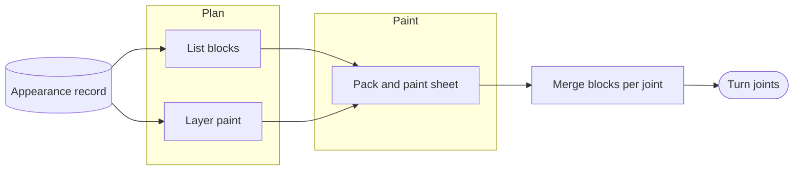

# ForeverQuest

ForeverQuest is a proof of concept for a browser role-playing game in the style of early online RPGs. It has a character creator and a small village to walk around. Every model and every texture in it is generated by code when the page loads. The project has no model files and no image files, so new art is a code change.

The game runs on HTML5 and WebGL. Its only runtime library is [Three.js](https://threejs.org/) 0.187, which renders the scenes. A copy of Three.js sits in [libs/three/](libs/three/), so the game runs without an install step.

## Running the Game

1. Install [Node.js](https://nodejs.org/) 24 or later.
2. Run `npm start` in the project folder. The command starts [tools/serve.js](tools/serve.js), a static file server with no dependencies, on port 8080.
3. Open `http://localhost:8080` in a browser.

The page loads its scripts as ES modules, and browsers do not load modules from `file://` addresses, so opening `index.html` straight from disk does not work. Any static file server works in place of `npm start`.

After a change to the Three.js version in `package.json`, run `npm install` and then `npm run vendor`, which copies the new build into `libs/three/`.

## Controls

| Screen | Input | Action |
|---|---|---|
| Creator | Drag the preview | Turns the character |
| Creator | Idle, Walk, Run, Wave | Plays an animation on the preview |
| Creator | Body, Face | Frames the whole body or the face |
| World | Click the ground | Walks to that spot |
| World | Click a villager | Walks to the villager and talks |
| World | W A S D | Walks relative to the camera |
| World | Drag, or the arrow keys | Turns and tilts the camera |
| World | Mouse wheel | Zooms the camera |
| World | R | Switches between walking and running |
| World | E | Waves |
| World | Appearance button | Opens the creator |
| Both | Retro | Renders 640 pixels wide and scales the picture up with hard pixel edges |

Mirelle, the tailor in the village square, also opens the creator. The creator saves the character to the browser's `localStorage` when the player enters the world or saves changes.

## Character Customisation

| Option | Choices |
|---|---|
| Race | Human, Elf, Dwarf, Halfling, Orc |
| Body | Male, Female |
| Height, Build | Sliders: height scales the character, build widens the torso and limbs |
| Skin | Four to six tones, from a palette that belongs to each race |
| Face | Stern, Weary, Gaunt, Broad, Young, Grim |
| Nose | Straight, Small, Broad, Hooked, Long |
| Eyes | Seven colours |
| Hair | Nine styles in 11 colours |
| Beard | None, Stubble, Moustache, Short, Full, Long, Forked |
| Markings | None, Scar, Weathered, War Paint, Tattoo |
| Equipment | Eight slots: head, chest, legs, feet, hands, back, main hand and off hand |

Each equipment item has a main colour and, for most items, a trim colour. Cloth and leather take colours from a cloth palette, and armour takes colours from a metal palette. The palettes, races and items are all data in [catalogue.js](js/character/catalogue.js).

A race changes proportions as well as size. A dwarf has a wide torso and short legs, an elf is tall and narrow with long ears, a halfling is small, and an orc is broad, with tusks and swept-back ears.

## Art Style

Characters and props are built from rigid, textured blocks, in the spirit of Minecraft and Lego but with a darker palette and a serious tone. Four rules make up the style.

- Rigid blocks. A character is six boxes, for the head, torso, arms and legs, plus clip-on blocks such as hair, beards, helmets, pauldrons, cloaks and weapons. Each block turns at one joint and never bends, so nothing stretches or clips.
- Pixel textures. Every face of every block carries a pixel-art texture at one density: 16 texels across a head, about 2 centimetres a texel. The textures are painted in code at load, with nearest filtering.
- Heroic proportions. The head is about 1/5.5 of a character's height, large enough for a readable face at play distance.
- A dark mood. Muted earth colours, fog, cold moonlight with shadows, and warm lamplight from windows, lanterns and lamp posts.

The Retro toggle renders at 640 pixels wide and scales the picture up with hard pixel edges.

## How a Character Is Built

The character system turns an appearance record into a few blocks, one texture sheet and one mesh per joint. The diagram below shows the modules involved, from the record on the left to the animated model on the right.

1. [Appearance](js/character/appearance.js) holds the player's choices. It checks every change against the catalogue and tells its listeners when the record changes.
2. [Kit](js/character/kit.js) lists the blocks: the six body blocks, sized in texels by race, body type and the sliders, and the clip-on blocks for the nose, ears, hair, beard and equipment. [Outfit](js/character/outfit.js) lists the paint layers for each body block face: skin first, then clothing, then armour.
3. [Sheet](js/character/sheet.js) packs every face of every block into one texture and runs each face's painters. The painters come from [pixels.js](js/art/pixels.js), for materials such as cloth, leather, chain mail and plate, and from [face.js](js/art/face.js), for eyes, brows, mouths, beards, hair and markings.
4. [CharacterModel](js/character/character-model.js) merges the blocks of each joint into one mesh with [BlockBuilder](js/geometry/block-builder.js), and gives the character one material. The model rebuilds itself whenever the appearance changes.

A character has about 130 to 300 triangles and a sheet 256 texels wide. The [Animator](js/character/animator.js) poses the model by turning its joints each frame: legs and arms swing from the hips and shoulders, the head turns, and a cape swings back as the character moves. It has idle, walk, run and wave poses.

Equipment works in two ways. Most items repaint body faces, so a shirt paints the torso and upper arms and boots paint the lower legs. Items that change the silhouette add blocks: helmets, hoods, hats, pauldrons, coat tails that hang from each leg, cloaks, packs, weapons, shields and a lantern that glows.

## Adding Content

A new hair style, item or race is a catalogue entry and a few blocks. A block is `{ joint, size, at, faces, rotation }`: its size and centre are in texels, its centre is relative to the joint, and `faces` maps face names (`front`, `back`, `left`, `right`, `top`, `bottom`, or `all`) to painters.

To add a hair style:

1. Add an entry with an `id` and a `name` to `HAIR_STYLES` in [catalogue.js](js/character/catalogue.js).
2. Add a case for the `id` to `addHair` in [kit.js](js/character/kit.js) for any blocks the style needs, such as a tail or a crest. The head block spans 16 texels on each axis, from its base at the neck.
3. Add the style to `hair` in [face.js](js/art/face.js) when it changes the hair painted on the head itself.
4. Run `npm test`. The character model test builds every option for every race and body type, and fails on a vertex that is not a number, a UV off the sheet, more than 1,200 triangles or a sheet taller than 512 texels.

To add an equipment item, add it to the slot's list in `EQUIPMENT` with the palette of its main colour and trim. When the item paints the body, add a case to [outfit.js](js/character/outfit.js). When it adds blocks, add a case to [kit.js](js/character/kit.js).

To add a race, add an entry to `RACES` with its torso, arm and leg sizes in texels, its ears and its skin tones. Add name syllables to [names.js](js/character/names.js), or the race's random names use the human syllables.

To add a world texture, add a name and a painter to `LAYERS` in [world-textures.js](js/world/world-textures.js). A world texture is 32 by 32 texels and covers 2 metres.

## The World

The village of Hearthmere sits on a grid of 96 by 96 one-metre tiles. [Terrain](js/world/terrain.js) raises each tile in quarter-metre steps from seeded noise, flattens the village, sinks a lake and lays paths, then types each tile as grass, moss, mud, cobble, sand or stone. Where the ground drops, the tile shows an earth or rock face.

[Props](js/world/props.js) builds every prop from textured blocks: jettied timber houses on stone plinths with stepped slate or thatch roofs, stone cottages, a chapel with a bell tower, a graveyard, a well, lamp posts, stocks, a cart, barrels, crates, sacks, fences, a signpost, a gibbet, pines, oaks, dead trees, rocks, bushes and weeds. [World](js/world/world.js) places them and merges them into one mesh, so the props draw in one call. All world blocks share one material, which reads its textures from one texture array.

Characters can step up at most half a metre from one tile to the next, and cannot enter the lake. Fourteen villagers walk around the village. Seven have set appearances and lines in [residents.js](js/game/residents.js). The other seven come from the same random generator as the creator's Randomise button.

## Project Layout

| Folder | Holds |
|---|---|
| [js/art/](js/art/) | The pixel painters for materials, faces and hair |
| [js/geometry/](js/geometry/) | BlockBuilder, which turns blocks into meshes |
| [js/character/](js/character/) | The catalogue, appearance record, kit, outfit, sheet, model and animator |
| [js/world/](js/world/) | Terrain, props, world textures, water and the world's collision |
| [js/game/](js/game/) | Actors, villager behaviour, camera, input and the in-game HUD |
| [js/ui/](js/ui/) | The character creator and its controls |
| [js/engine/](js/engine/) | The WebGL renderer loop, the world material, the raster and the graphics settings |
| [js-tests/](js-tests/) | The unit and browser test suites |
| [lint/](lint/) | The project's ESLint rules |
| [tools/](tools/) | The static file server and the Three.js copy script |

## Documentation

The [docs/](docs/) folder describes the architecture, the character kit and the world in more depth.

## Tests and Lint

| Command | Effect |
|---|---|
| `npm install` | Installs ESLint and Three.js for the tests and the lint |
| `npm test` | Runs the unit suite and the lint tests |
| `npm run test:browser` | Plays the game in headless Chrome or Edge |
| `npm run lint` | Checks the code against the coding style |

[js-tests/README.md](js-tests/README.md) explains the test suites, and [lint/README.md](lint/README.md) lists the lint rules.

## Limitations

The project is a proof of concept, and it leaves out most of a game.

- Click-to-move walks in a straight line and stops at the first obstacle or cliff. The game has no pathfinding.
- Characters walk through each other.
- Equipment is cosmetic. The game has no combat, inventory or stats.
- The game has no server, so it has no other players.
