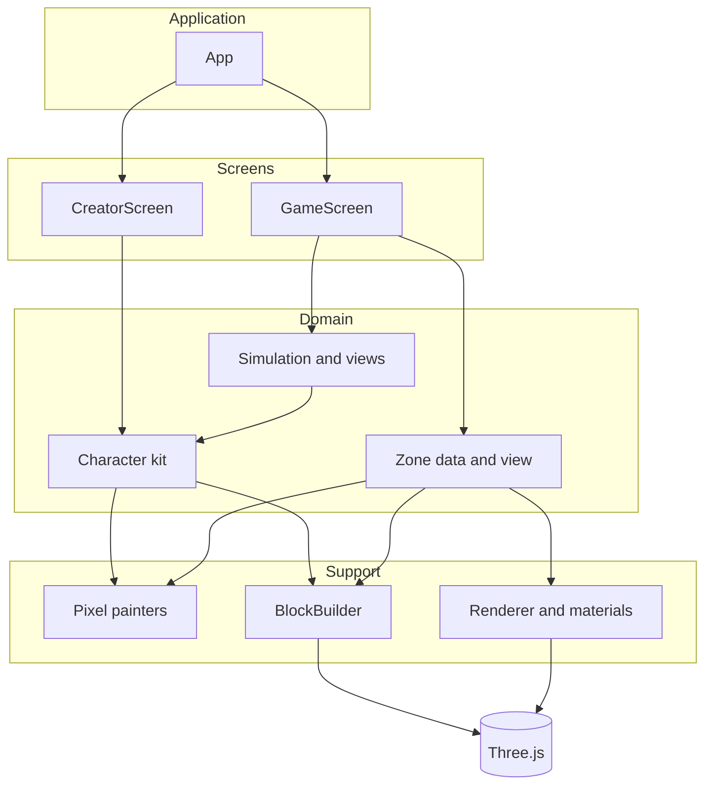
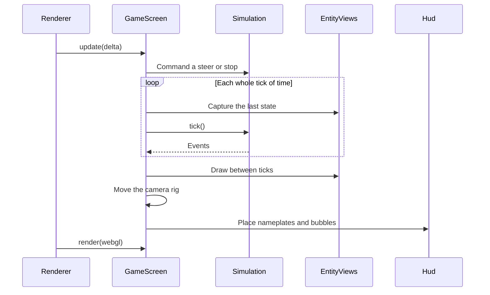

# Architecture

ForeverQuest is a browser game written in plain ES modules. [Three.js](https://threejs.org/) renders the scenes and is the only runtime library. The game has no build step: the browser loads the modules from [js/](../js/) through an import map in [index.html](../index.html), which points `three` at the copy in [libs/three/](../libs/three/).

## Layers

The code falls into five layers. Each layer uses only the layers below it.

| Layer | Folder | Modules |
|---|---|---|
| Application | [js/](../js/) | `main.js` opens the asset source and boots the app. `App` loads the library of rigs and bodies and the world atlas, then owns the renderer, the material library, the graphics settings, the player's appearance and both screens. `CharacterStore` saves the appearance to `localStorage` |
| Screens | [js/ui/](../js/ui/), [js/game/](../js/game/) | `CreatorScreen` is the character creator. `GameScreen` turns input into simulation commands and events into the HUD, and runs the ticks, the views and the camera |
| Domain | [js/kit/](../js/kit/), [js/character/](../js/character/), [js/sim/](../js/sim/), [js/render/](../js/render/), [js/game/](../js/game/) | `Library` holds the baked rigs, bodies, parts, stamps, palettes and archetypes. The fitter sizes and places a body's bones, the dresser lists the worn parts' blocks and face layers, and the compositor paints stamps. The character kit turns an `Appearance` into a `CharacterModel`. `ZoneData` holds a zone's loaded regions of cubes and its light spots, with no Three.js or page. `RegionStreamer` loads and frees regions around the player. `ZoneView` draws a zone in tiles of chunks, meshed in web workers, with its water, sky and lights. `Simulation` advances the entities on a fixed tick, `NpcBrain` wanders and talks, and `EntityView` draws an entity between ticks |
| Support | [js/art/](../js/art/), [js/geometry/](../js/geometry/), [js/engine/](../js/engine/) | The colour maths, `BlockBuilder`, `Raster`, `AssetSource`, the PNG decoder, `WorldAtlas`, `Renderer`, `MaterialLibrary` and `GraphicsSettings` |
| Utilities | [js/util/](../js/util/) | Seeded random numbers and value noise |

The game reads baked assets, which the bake writes from authoring code in [content/](../content/). [Assets and the Bake](assets.md) describes that boundary and the lint rules that keep it.

The modules below the screens use no DOM, so the unit suite in [js-tests/unit/](../js-tests/unit/) runs them in Node. It builds real character models, texture sheets and the whole world without WebGL.

## Screens and the Frame Loop

`Renderer` owns the `WebGLRenderer` and one active screen. A screen is any object with `show()`, `hide()`, `resize(width, height)`, `update(delta)` and `render(webgl)`. `App` swaps between the creator and the game with `renderer.setScreen()`.

Each animation frame, `Renderer` measures the time since the last frame, caps it at 50 ms, then calls `update` and `render` on the screen.

## Simulation and Views

The game screen keeps the game's state apart from what draws it. [Simulation](../js/sim/simulation.js) holds the zone's data and an [Entity](../js/sim/entity.js) for the player and each villager: plain state such as position, heading and target, with no Three.js and no page. It advances on a fixed tick of 20 a second, so it gives the same result at any frame rate and could run on a server. An [EntityView](../js/render/entity-view.js) for each entity owns its character model and clips, and draws the entity between the last two ticks.

The game screen turns input into commands, such as `moveTo`, `steer`, `stop`, `run`, `talk` and `wave`, which the simulation applies at the start of its next tick. The simulation reports what happened as events: `entered`, `said`, `waved` and `running`. The game screen turns those into chat lines, bubbles, waves and the tailor's creator. The sequence below shows one frame.

A tick applies the queued commands, moves the player towards a villager they are talking to, runs each villager's [NpcBrain](../js/sim/npc-brain.js), then moves every entity against the zone's colliders. The screen catches up at most five ticks a frame, so a very slow frame slows the game rather than freezing it.

`GameScreen.pause()` stops the ticks and `stepTicks(count)` runs a number of them at once. The browser specs use both, so they measure in ticks, not seconds.

## State and Events

Each class owns its state and changes it only through its own methods. A class that others react to keeps a list of listeners and emits a change, as the coding style describes. The main sources of change are:

| Source | Emits when | Listeners |
|---|---|---|
| `Appearance` | A field, an item or a tint changes, or the record is replaced | `CharacterModel` rebuilds; `CreatorScreen` redraws its tab; `GameScreen` updates the HUD name card |
| `CharacterModel` | It finishes a rebuild | `CreatorScreen` updates the triangle count |
| `GraphicsSettings` | Stepped light or day is switched | The toggle buttons; `GameScreen` sets the terrain material and the zone view's daylight |
| `Simulation` | An entity enters, says a line, waves, or starts or stops running | `GameScreen` updates the chat, bubbles, views and HUD |

Every `onChange` and `onEvent` returns a function that unsubscribes the listener. The game screen and the creator keep these functions and call them in `dispose()`, which also frees their models, views and DOM.

The player's `Appearance` lives in `App`. The creator edits a separate draft copy, and `App` copies the draft back with `appearance.replace()` when the player saves. Every view of the player rebuilds from that one change event.

## Units and Coordinates

| Space | Unit | Axes |
|---|---|---|
| World | Metres | +y is up. A character facing a heading of 0 faces +z, and its left is +x |
| Character kit | Texels, where `Fitter.TEXEL` is 1/48 metre (about 2 cm), so a 16-texel head is one world cube | Each block's size and centre are in texels, relative to its joint |
| Block faces | Texels on the face | u runs left to right and v bottom to top as seen from outside the block (see [block-builder.js](../js/geometry/block-builder.js)) |
| Painter areas | Texels in a raster | `{ x, y, w, h }` with y counting down from the top row. Drawing wraps inside the area |
| Zone cells | Cubes of 1/3 metre | Cells are whole numbers; `ZoneData` turns them into metres for heights, and props and spawns are placed in metres |
| World textures | 48 texels a metre, 16 to a world cube face | Each layer is 64 by 64 texels and tiles every 1 1/3 metres |

Rasters are painted top-down and uploaded to the GPU bottom-up, so `Sheet.texture()` and `WorldAtlas` flip the rows.

## Rendering

The world uses one material, `MaterialLibrary.world`. It is a Lambert material patched to read a texture array: every world vertex carries a `uv` and a `layer`, and the layers that the atlas marks as glow also light themselves. Each character has its own Lambert material whose map is its texture sheet and whose emissive map holds glowing texels such as a lantern. A directional moonlight casts shadow maps, and six point lights follow the lit windows and lamps nearest the player.

## Testing and Debugging

`main.js` exposes the app as `window.foreverQuest`. The browser specs in [js-tests/browser/specs/](../js-tests/browser/specs/) read game state through it, such as `foreverQuest.game.player.position`, and step the simulation with `foreverQuest.game.stepTicks(count)`. [js-tests/README.md](../js-tests/README.md) describes both test suites and when to run them.
