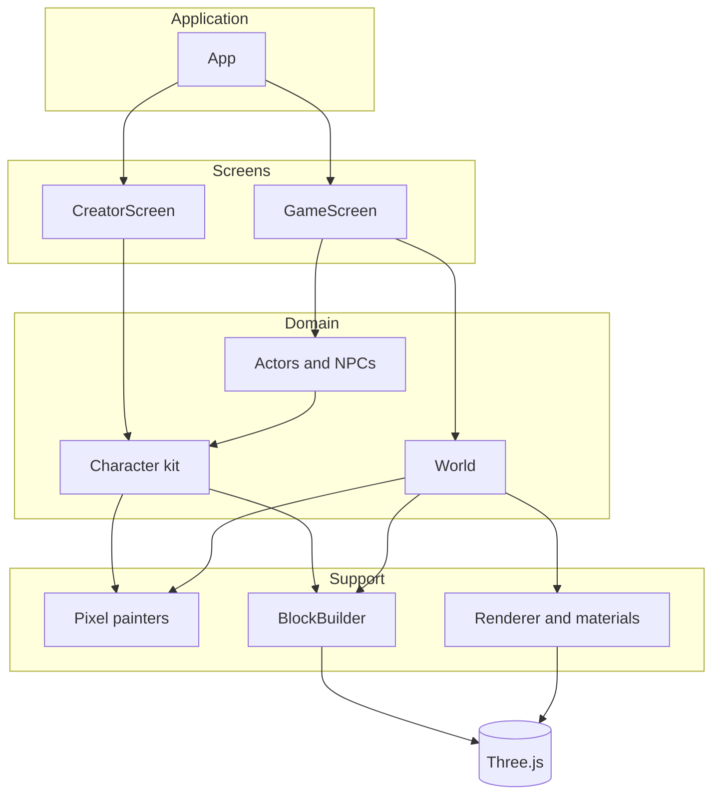
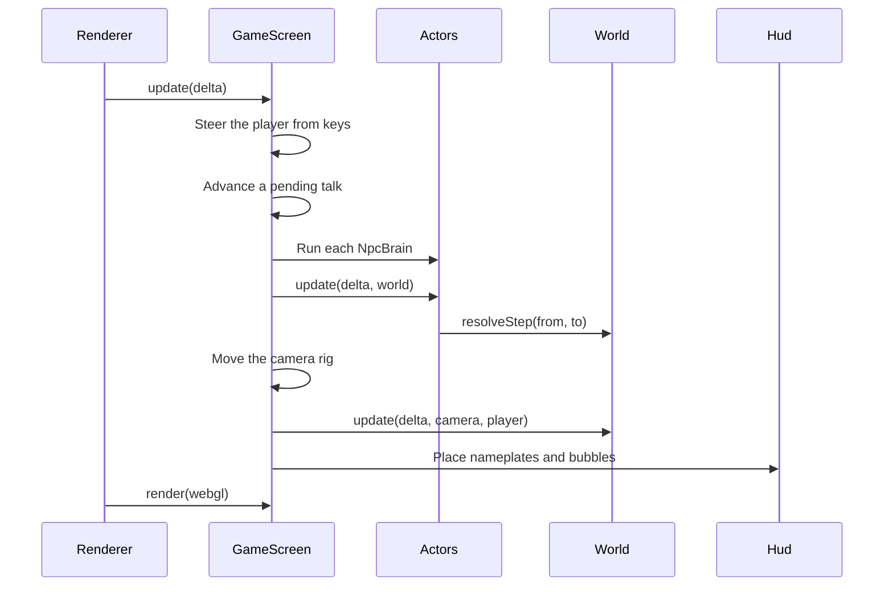

# Architecture

ForeverQuest is a browser game written in plain ES modules. [Three.js](https://threejs.org/) renders the scenes and is the only runtime library. The game has no build step: the browser loads the modules from [js/](../js/) through an import map in [index.html](../index.html), which points `three` at the copy in [libs/three/](../libs/three/).

## Layers

The code falls into five layers. Each layer uses only the layers below it.

| Layer | Folder | Modules |
|---|---|---|
| Application | [js/](../js/) | `main.js` opens the asset source and boots the app. `App` loads the world atlas, then owns the renderer, the material library, the graphics settings, the player's appearance and both screens. `CharacterStore` saves the appearance to `localStorage` |
| Screens | [js/ui/](../js/ui/), [js/game/](../js/game/) | `CreatorScreen` is the character creator. `GameScreen` runs the world: input, camera, actors, talking and the HUD |
| Domain | [js/character/](../js/character/), [js/world/](../js/world/), [js/game/](../js/game/) | The character kit turns an `Appearance` into a `CharacterModel`. `World` builds the terrain, props, lights and collision. `Actor` moves a character through the world, and `NpcBrain` wanders and talks |
| Support | [js/art/](../js/art/), [js/geometry/](../js/geometry/), [js/engine/](../js/engine/) | The pixel painters, `BlockBuilder`, `Raster`, `AssetSource`, the PNG decoder, `WorldAtlas`, `Renderer`, `MaterialLibrary` and `GraphicsSettings` |
| Utilities | [js/util/](../js/util/) | Seeded random numbers and value noise |

The game reads baked assets, which the bake writes from authoring code in [content/](../content/). [Assets and the Bake](assets.md) describes that boundary and the lint rules that keep it.

The modules below the screens use no DOM, so the unit suite in [js-tests/unit/](../js-tests/unit/) runs them in Node. It builds real character models, texture sheets and the whole world without WebGL.

## Screens and the Frame Loop

`Renderer` owns the `WebGLRenderer` and one active screen. A screen is any object with `show()`, `hide()`, `resize(width, height)`, `update(delta)` and `render(webgl)`. `App` swaps between the creator and the game with `renderer.setScreen()`.

Each animation frame, `Renderer` measures the time since the last frame, caps it at 50 ms, then calls `update` and `render` on the screen. The sequence below shows one frame of the game screen.

## State and Events

Each class owns its state and changes it only through its own methods. A class that others react to keeps a list of listeners and emits a change, as the coding style describes. The main sources of change are:

| Source | Emits when | Listeners |
|---|---|---|
| `Appearance` | A field, an item or a tint changes, or the record is replaced | `CharacterModel` rebuilds; `CreatorScreen` redraws its tab; `GameScreen` updates the HUD name card |
| `CharacterModel` | It finishes a rebuild | `CreatorScreen` updates the triangle count |
| `GraphicsSettings` | Retro mode changes | The Retro toggle buttons |

The player's `Appearance` lives in `App`. The creator edits a separate draft copy, and `App` copies the draft back with `appearance.replace()` when the player saves. Every view of the player rebuilds from that one change event.

## Units and Coordinates

| Space | Unit | Axes |
|---|---|---|
| World | Metres | +y is up. A character facing a heading of 0 faces +z, and its left is +x |
| Character kit | Texels, where `Kit.TEXEL` is 1.8 / 88 metres (about 2 cm) | Each block's size and centre are in texels, relative to its joint |
| Block faces | Texels on the face | u runs left to right and v bottom to top as seen from outside the block (see [block-builder.js](../js/geometry/block-builder.js)) |
| Painter areas | Texels in a raster | `{ x, y, w, h }` with y counting down from the top row. Drawing wraps inside the area |
| Terrain | One-metre tiles | Tile heights rise in steps of `Terrain.STEP`, 0.25 metres |
| World textures | 16 texels a metre | Each layer is 32 by 32 texels and tiles every 2 metres |

Rasters are painted top-down and uploaded to the GPU bottom-up, so `Sheet.texture()` and `WorldAtlas` flip the rows.

## Rendering

The world uses one material, `MaterialLibrary.world`. It is a Lambert material patched to read a texture array: every world vertex carries a `uv` and a `layer`, and the layers that the atlas marks as glow also light themselves. Each character has its own Lambert material whose map is its texture sheet and whose emissive map holds glowing texels such as a lantern. A directional moonlight casts shadow maps, and a point light sits at each lit window and lamp.

The Retro toggle sets the renderer's pixel ratio so that it draws 640 pixels across, and the canvas scales the picture up with `image-rendering: pixelated`.

## Testing and Debugging

`main.js` exposes the app as `window.foreverQuest`. The browser specs in [js-tests/browser/specs/](../js-tests/browser/specs/) read game state through it, such as `foreverQuest.game.player.position`. [js-tests/README.md](../js-tests/README.md) describes both test suites and when to run them.
