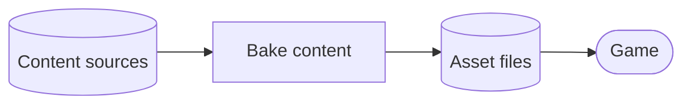

# Assets and the Bake

ForeverQuest separates the code that makes art from the code that plays the game. Authoring code in [content/](../content/) paints and builds the art. The bake runs that code and writes asset files into `assets/`. The game reads only those files, so it holds no painter or generator for anything that has been baked.

The world textures, the rigs and the bodies are baked. Character parts, props and the zone still run their generators in the game, and move to the bake in later stages of the restructure.

## The Boundary

The diagram shows the route from authoring to play. The asset files are the only route.



| Folder | Holds | Read by the game |
|---|---|---|
| [content/](../content/) | Authoring code and data, such as the world texture painters, the rigs and the bodies, and the id migrations | No |
| [tools/bake/](../tools/bake/) | The bake and the PNG writer | No |
| `assets/` | The baked files and their manifest. Git ignores the folder, because the bake rebuilds it | Yes |
| [assets.lock.json](../assets.lock.json) | A hash of every baked file and every content id, under version control | No |

The lint enforces the boundary:

- A module under `js/` cannot import from `content/` or `tools/`.
- A module under `js/sim/` cannot import Three.js or a module from `js/engine/`, `js/render/` or `js/ui/`, and cannot use a page global such as `window` or `document`.
- A module under `content/` or `tools/bake/` cannot call `Math.random`, `Date.now` or `performance.now`, or create a `Date`, so every bake writes the same files.

Content may import game modules, such as the pixel painters in [js/art/](../js/art/).

## Running the Bake

| Command | Effect |
|---|---|
| `npm run bake` | Bakes `content/` into `assets/` and reports any file that differs from the lock file |
| `npm run bake -- --accept` | Bakes, then writes the lock file from the result |
| `npm run bake -- --watch` | Bakes, then bakes again each time a file under `content/` or `js/` changes |

`npm start`, `npm test` and the browser test runner bake first, so the game and the tests never read stale assets. The watch mode runs each bake in a new Node process, because Node keeps the modules a process has imported and would not see the change.

## The Lock File

The lock file records what the owner has accepted. After each bake, the asset lock test compares `assets/manifest.json` with `assets.lock.json` and fails when a file was added, changed or removed. An art change is therefore deliberate:

1. Change the content and run `npm run bake`. The bake lists the files that differ from the lock file.
2. Review the changed assets, for example by opening the PNG files or running the game.
3. Run `npm run bake -- --accept` to record the change, and commit the lock file with the content change.

## Ids and Migrations

The lock file also records every content id by kind: each world texture, rig, body, stamp and part, each part as `slot/id`, and each body's variants as `body/variant`. A bake fails when an id that the lock file records is gone, unless [migrations.js](../content/migrations.js) maps it to a replacement that still exists. The bake writes the maps to `migrations.json`, and saved characters load through them.

```javascript
export const IDS =
{
    "world-texture": { turf: "grass" },
};
```

## Asset Files

| File | Holds |
|---|---|
| `manifest.json` | Each file's SHA-256 hash and size, and the ids by kind |
| `textures/world.png` | Every world texture, 32 by 32 texels, stacked top to bottom in atlas order |
| `textures/world.json` | The texture size, the texels per metre, and each layer's name and glow flag |
| `models/index.json` | The rig ids, and the body ids in display order |
| `models/rigs/<id>.json` | A rig, with each pivot and centre compiled into a linear form of box sizes |
| `models/bodies/<id>.json` | A body, checked against its rig |
| `models/stamps.png`, `models/stamps.json` | Every stamp packed into one sheet, and each stamp's rectangle and whether it takes a tint |
| `models/parts/index.json`, `models/parts/<slot>/<id>.json` | The part ids, and each part checked against the rigs that offer its slot |
| `migrations.json` | The id maps from [migrations.js](../content/migrations.js) |

Texels are stored as 8-bit RGBA PNG, so any image viewer opens them. The bake writes PNG with Node's built-in `zlib` and no row filters, so the same texels always give the same bytes.

## Loading Assets

[AssetSource](../js/engine/asset-source.js) reads baked files through a function that returns raw bytes. In the browser, `AssetSource.http("assets/")` fetches them. The unit tests open the same files from disk with [js-tests/helpers/assets.js](../js-tests/helpers/assets.js). The source reads the manifest first and refuses a path that the manifest does not list.

The game decodes PNG itself in [png.js](../js/engine/png.js), with the `DecompressionStream` that both browsers and Node provide. A browser's image decoder may convert colour spaces or premultiply alpha, which would change the texels.

[Library](../js/kit/library.js) loads the rigs, the bodies and the id maps. [WorldAtlas](../js/engine/world-atlas.js) loads the world texture image and index. It maps texture names to layers, lists the glow layers for the world material, and flips each layer's rows for upload, because images store rows top-down and textures upload them bottom-up.

## Adding Content

[Character Kit](character-kit.md#adding-content) describes how to add a race or a creature. The [workbench](workbench.md) shows baked bodies before they reach the game.

## Adding a World Texture

1. Add an entry to `TEXTURES` in [content/world-textures.js](../content/world-textures.js) with a `name`, a whole-number `seed` that no other texture uses, a `paint` function, and `glow: true` if the texture lights itself.
2. Run `npm run bake`, check the new layer in `assets/textures/world.png`, then run `npm run bake -- --accept`.

Each texture has its own seed, so adding or moving a texture leaves the texels of the others unchanged. The bake fails on an invalid or repeated name, a missing seed or a texel that is not opaque.
