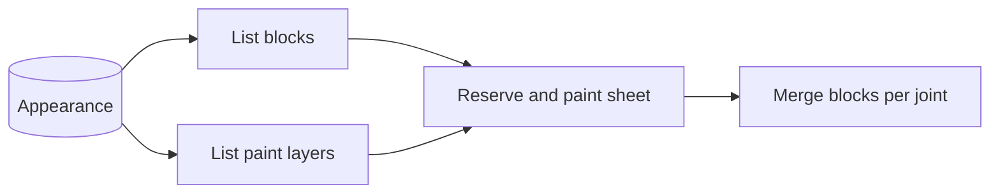
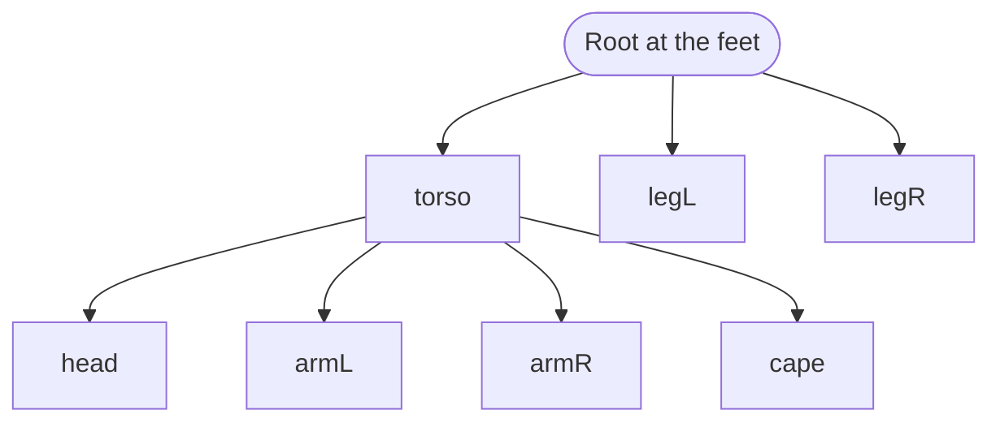

# Character Kit

A character is a set of rigid, textured blocks hung on seven joints. The kit builds every character from an `Appearance` record. It needs no model or image files, and no block ever bends, so characters never stretch or clip.

## From Appearance to Model

`CharacterModel.rebuild()` runs four steps every time the appearance changes.

1. [kit.js](../js/character/kit.js) sizes the six body blocks from the race, body type and sliders, then lists the clip-on blocks for the nose, ears, tusks, hair, beard and equipment.
2. [outfit.js](../js/character/outfit.js) lists, for each face of each body block, the painters to run in order: skin, then the face and hair, legs, feet, chest and hands.
3. [sheet.js](../js/character/sheet.js) reserves a texel area on one texture for each face of every block, then runs the painters into those areas.
4. [character-model.js](../js/character/character-model.js) merges each joint's blocks into one mesh with [BlockBuilder](../js/geometry/block-builder.js), creates one material from the sheet, and hangs the meshes on the joints.

The model then disposes the previous geometry, material and textures. A character has about 130 to 300 triangles.

## Appearance and Catalogue

[catalogue.js](../js/character/catalogue.js) holds every option as data: the palettes, races, body types, faces, noses, hair and beard styles, markings, equipment slots and items, and the archetypes that random villagers draw from. [appearance.js](../js/character/appearance.js) holds one character's choices and checks each change against the catalogue.

| Field | Holds |
|---|---|
| `name` | Up to 20 letters, spaces, hyphens and apostrophes |
| `race`, `body` | Ids from `RACES` and `BODY_TYPES` |
| `height`, `build` | Numbers from -1 to 1 |
| `skin` | A colour from the race's `skins` |
| `face`, `nose`, `hair`, `beard`, `markings` | Ids from the matching catalogue list |
| `eyes`, `hairColour` | Colours from `EYE_COLOURS` and `HAIR_COLOURS` |
| `equipment` | For each slot, `{ item, colour, trim }`, where each colour comes from the palette the item names |

`Appearance.normalise()` replaces any value that the catalogue does not hold with a default. A saved character whose item or style no longer exists therefore loads with the default in its place.

## Body and Joints

Every head is 16 texels on a side. The legs split the torso's width between them and share its depth. The race sets the torso, arm and leg sizes; the female body narrows the torso and arms; the build slider widens the torso and limbs; and the height slider scales the whole character by up to 6 percent. A human male is 88 texels, or 1.8 metres, tall.

The joints hang from the character's root at its feet. The diagram shows the hierarchy.

| Joint | Pivot | Body block |
|---|---|---|
| `legL`, `legR` | The hip, at the top of the leg | The leg hangs below the pivot |
| `torso` | The hip line | The torso stands above the pivot |
| `head` | The top of the torso | The head sits above the pivot |
| `armL`, `armR` | The shoulder, 2 texels below the top of the torso, beside it | The arm hangs below, with its top 2 texels above the pivot |
| `cape` | The back of the torso, at the shoulders | None; capes and cloaks hang here so they can swing back |

The bottom 5 rows of each arm are the hand, and the lower rows of each leg are the foot. Gloves, gauntlets, shoes and boots paint those rows.

## Blocks

A block is a plain object:

| Property | Holds |
|---|---|
| `joint` | The joint the block hangs on |
| `size` | `[width, height, depth]` in texels |
| `at` | The block's centre in texels, relative to the joint |
| `rotation` | Optional `[x, y, z]` angles in radians, turned about the block's centre |
| `faces` | Painters by face name: `front`, `back`, `left`, `right`, `top`, `bottom`, or `all` as the fallback |
| `part` | Set only on body blocks, to the name the outfit layers use |

A face that a painter leaves transparent stays see-through, because the character material discards texels with alpha below 0.5. The hood and the mail coif use this for their face openings, and the cloak for its ragged hem.

Held items use `holding(joint, grip)` in [kit.js](../js/character/kit.js), which places blocks along a weapon held forwards with its tip low. Poles such as staffs, spears and pitchforks stand upright in the hand instead.

## Texture Sheet and Painters

`Sheet` packs faces left to right in rows, 256 texels wide, and grows downwards as needed. It insets each face's UVs by a hundredth of a texel, so nearest sampling never reads a neighbouring face. A second raster of the same size holds the glow that the material's emissive map reads.

A painter is a function `(raster, area, random, glow)`. It draws inside `area` only, and draws into `glow` only when the texels should light themselves. [pixels.js](../js/art/pixels.js) holds the material painters, such as `cloth`, `leather`, `chain`, `plate`, `planks` and `stone`, and the drawing helpers `rows`, `columns`, `rect`, `dot` and `grit`. [face.js](../js/art/face.js) paints the 16 by 16 face, with its eyes, brows, mouth, beard and markings, and the hair on the other faces of the head.

Each character paints with a random generator seeded from its name and race, so the same character always gets the same texels.

## Animation

[Animator](../js/character/animator.js) turns joints each frame and never moves them. It blends from idle to walking at 2.4 metres a second and to running at 5.2: the legs and arms swing in opposite phase, the torso bobs and leans, the head looks around when standing, and the cape swings back with speed. Held items change the arms' rest angles, and `wave()` raises the right arm for 2.2 seconds.

## Adding Content

Each change below ends with `npm test`. The character model test builds every option for every race and body type and fails on a vertex that is not a number, a UV off the sheet, more than 1,200 triangles or a sheet taller than 512 texels.

### A Hair Style

1. Add `{ id, name }` to `HAIR_STYLES` in [catalogue.js](../js/character/catalogue.js).
2. Add a case to `addHair` in [kit.js](../js/character/kit.js) for any blocks the style adds, such as a tail or a crest, on the `head` joint.
3. When the style changes the hair painted on the head itself, add a case to `hair` in [face.js](../js/art/face.js).

### An Equipment Item

1. Add the item to its slot's list in `EQUIPMENT`, with its `primary` and `trim` palettes and default colours.
2. When it paints the body, add a case to the slot's function in [outfit.js](../js/character/outfit.js), such as `paintChest`.
3. When it adds blocks, add a case to the slot's function in [kit.js](../js/character/kit.js), such as `addHeadgear`.
4. When a held item needs a different arm pose, extend `poseArms` in [animator.js](../js/character/animator.js).

### A Race

1. Add an entry to `RACES` with its `torso`, `arm` and `leg` sizes in texels, its `ears` shape, its `skins`, and `hasTusks` if it has them.
2. Add a case to `addFeatures` in [kit.js](../js/character/kit.js) for a new ear shape.
3. Add name syllables to [names.js](../js/character/names.js), or the race's random names use the human syllables.
