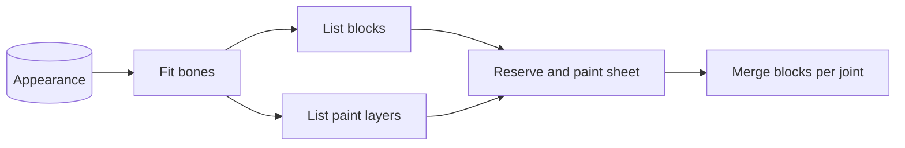
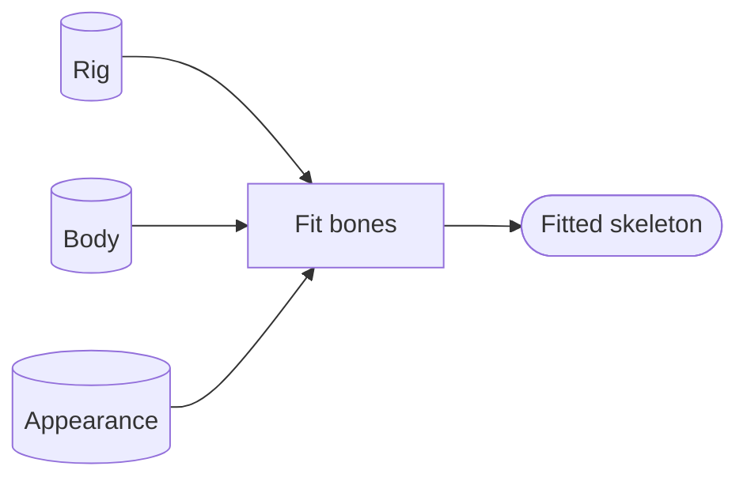

# Character Kit

A character is a set of rigid, textured blocks hung on the bones of a rig. The kit builds every character from an `Appearance` record, a body and its rig. No block ever bends, so characters never stretch or clip.

Rigs, bodies, parts, stamps, palettes and archetypes are content: authoring files in [content/](../content/), which the bake checks and writes to `assets/models/`. The game holds no painter and no part id; it fits, dresses and paints characters from the baked files.

## From Appearance to Model

`CharacterModel.rebuild()` runs these steps every time the appearance changes.

1. [fitter.js](../js/kit/fitter.js) sizes the body's boxes from its variant and sliders, places each bone, and lists one body block for each bone with a box.
2. For a body whose surface is `outfit`, [dresser.js](../js/kit/dresser.js) lists the blocks of every part the character wears, and, for each face of each body block, the layers to paint in order: the rig's base skin layer, then each part in the rig's slot order. For a body whose surface is `placeholder`, [placeholder.js](../js/character/placeholder.js) paints every body block in the skin colour, shaded per bone.
3. [sheet.js](../js/character/sheet.js) reserves a texel area on one texture for each face of every block, then runs the painters into those areas.
4. [character-model.js](../js/character/character-model.js) merges each joint's blocks into one mesh with [BlockBuilder](../js/geometry/block-builder.js), creates one material from the sheet, and hangs the meshes on the joints. It creates a new set of joints when the rig changes.

The model then disposes the previous geometry, material and textures. A character has about 130 to 300 triangles. The model's `plan` holds the fit, the height in metres, the height of the face bone's box and each bone's rest position.

## Appearance

[appearance.js](../js/character/appearance.js) holds one character's choices and checks each change against the [Library](../js/kit/library.js) of baked content: the bodies, the parts of each slot, the palettes, the defaults in [content/appearance.js](../content/appearance.js), and the archetypes in [content/archetypes.js](../content/archetypes.js) that random villagers draw from.

| Field | Holds |
|---|---|
| `name` | Up to 20 letters, spaces, hyphens and apostrophes |
| `version` | The record's schema version, written by `toJSON()`. The current version is 2 |
| `body`, `variant` | A body id from the library, and one of that body's variants |
| `height`, `build` | Slider values from -1 to 1 |
| `skin` | A colour from the body's `skins` |
| `face`, `nose`, `hair`, `beard`, `markings` | The id of a part in that slot |
| `eyes`, `hairColour` | Colours from the `eyes` and `hair` palettes |
| `equipment` | For each gear slot of the body's rig, `{ item, colour, trim }`, where each colour comes from the palette the part names |

`Appearance.normalise()` first migrates the record. A version 1 record, which named the body `race` and the variant `body`, moves to the version 2 fields, and a body or variant id that [content/migrations.js](../content/migrations.js) maps moves to its replacement. It then replaces any value that the library does not hold with a default. A saved character whose item or style no longer exists therefore loads with the default in its place.

Any body in the library is valid, but the creator offers only the playable bodies. The workbench shows the others, such as the wolf.

## Rigs and Bodies

A rig describes a kind of skeleton, and a body gives a rig its sizes. The diagram shows how the fitter combines them with the appearance.

### Rigs

A rig file in [content/rigs/](../content/rigs/) exports a `RIG`:

| Field | Holds |
|---|---|
| `id` | The rig's id |
| `boxes` | The names of the boxes a body must size, such as `head`, `torso`, `arm` and `leg` |
| `faceBone` | The bone that a face view frames |
| `bones` | The bones, in the order their faces pack the sheet |

Each bone has a `name`, a `parent` (another bone, or `root` at the feet), an optional `box`, a `pivot` and, with a box, a `centre`. The pivot places the joint in the parent's frame, and the centre places the bone's box in its own frame. Each coordinate is a number or a sum of box sizes in texels, such as `"torso.w/2 + arm.w/2"` or `"torso.h - 2"`, where `w`, `h` and `d` are a box's width, height and depth. An optional `rest` gives the bone's angles in radians about x, y and z. A bone `{ name, mirror }` copies another bone across x, so `armR` mirrors `armL`. The bake compiles each sum into a linear form, so the game parses no expressions.

[humanoid.js](../content/rigs/humanoid.js) is the rig of the five races and the ogre:

| Bone | Parent | Pivot | Box |
|---|---|---|---|
| `head` | `torso` | The top of the torso | Sits above the pivot |
| `torso` | `root` | The top of the legs | Stands above the pivot |
| `armL`, `armR` | `torso` | Beside the torso, 2 texels below its top | Hangs below, with its top 2 texels above the pivot |
| `legL`, `legR` | `root` | The hip, at the top of the leg | Hangs below the pivot |
| `cape` | `torso` | The back of the torso, at the shoulders | None; capes and cloaks hang here so they can swing back |

The bottom 5 rows of each arm are the hand, and the lower rows of each leg are the foot. Gloves, gauntlets, shoes and boots paint those rows. [quadruped.js](../content/rigs/quadruped.js) is the rig of the wolf: a body box along z, a head and snout at +z, four legs and a tail.

### Bodies

A body file in [content/bodies/](../content/bodies/) exports a `BODY`. Other modules in that folder, such as [humanoid-shared.js](../content/bodies/humanoid-shared.js), hold data that several bodies share.

| Field | Holds |
|---|---|
| `id`, `name`, `rig` | The body's id and name, and the rig it uses |
| `order`, `playable` | The body's place in lists, and whether the creator offers it |
| `surface` | `outfit` for the races, which wear parts and paint faces; `placeholder` for a body whose art is not made yet |
| `boxes` | Each of the rig's boxes as `[width, height, depth]` in texels |
| `variants` | Each variant's `id`, `name` and the change it makes to each box, such as the female variant's narrower torso |
| `sliders` | `build`, which adds a box change for each whole step of the slider, and `height`, which scales the whole character |
| `measures` | The collision `radius`, the `walk` and `run` speeds in metres a second, the `nameplate` height above the model and the camera `focus` height, in metres |
| `skins` | The skin colours on offer, as lower-case `#rrggbb` |
| `shades` | For a placeholder body, a shade factor for each bone's colour |
| `features` | The feature parts the body always wears, such as `earsLong` or `tusks` |
| `random` | Optional rules for random characters, such as the dwarf's beard odds |

Every head of an outfit body is 16 texels on a side, because the face and hair painters assume it. The humanoid bodies keep the legs at half the torso's width and its full depth, so every variant and build step changes the legs with the torso. A human male is 88 texels, or 1.8 metres, tall.

The bake checks every rig and body. It reports an unknown box or bone, a bone that is its own ancestor, a missing box size, a variant or build step that shrinks a box to nothing, a body that runs no faster than it walks, and an invalid colour.

## Blocks

A block is a plain object:

| Property | Holds |
|---|---|
| `joint` | The joint the block hangs on |
| `size` | `[width, height, depth]` in texels |
| `at` | The block's centre in texels, relative to the joint |
| `rotation` | Optional `[x, y, z]` angles in radians, turned about the block's centre |
| `faces` | Painters by face name: `front`, `back`, `left`, `right`, `top`, `bottom`, or `all` as the fallback |
| `part` | Set only on body blocks, to the bone whose face layers paint it |

A face that a painter leaves transparent stays see-through, because the character material discards texels with alpha below 0.5. The hood and the mail coif use this for their face openings, and the cloak for its ragged hem.

Weapons such as swords hang from the `grip.R` socket, which points them forwards with the tip low. Poles such as staffs, spears and pitchforks hang from `hand.R` and stand upright.

## Texture Sheet and Painters

`Sheet` packs faces left to right in rows, 256 texels wide, and grows downwards as needed. It insets each face's UVs by a hundredth of a texel, so nearest sampling never reads a neighbouring face. A second raster of the same size holds the glow that the material's emissive map reads.

A painter is a function `(raster, area, random, glow)`. It draws inside `area` only, and draws into `glow` only when the texels should light themselves. In the game, every painter draws baked stamps through the compositor. The authoring painters that make the stamps are in [content/art/](../content/art/): [pixels.js](../content/art/pixels.js) holds the material painters, such as `cloth`, `leather`, `chain`, `plate`, `planks` and `stone`, and the drawing helpers, and [face.js](../content/art/face.js) paints hair on the faces of the head.

Each character paints with a random generator seeded from its name and body id, so the same character always gets the same texels.

## Baked Parts

Every face, nose, hair style, beard, marking, feature and equipment item is a part in [content/parts/](../content/parts/), one folder per slot. The bake checks each part and writes it to `assets/models/parts/`. Each part places its blocks exactly where the prototype's code did, on every playable body and variant; the stamps changed the texels a little, which the owner accepted.

### Sockets, Regions and Slots

The humanoid rig names the places where parts attach and paint:

| Field | Holds |
|---|---|
| `sockets` | Points on a bone, such as `hand.R`, with an optional rotation. `grip.R` is the hand turned so that a held weapon points forwards with its tip low. Every bone is also a socket at its pivot |
| `regions` | Areas of bone faces, such as `face`, `scalp`, `torso`, `sleeves` and `hands`, each a list of bones with optional faces and rows |
| `slots` | The slots the rig offers, in the order their parts paint. `feature` holds the parts the body lists |
| `gear` | The equipment slots, with the names the creator shows |
| `held` | The slots whose parts a hand holds, such as `mainHand` and `offHand` |
| `stances` | For each stance, the `rest` angle of the arm that holds the part and the `swing` factor that damps its swing |
| `base` | The layers every outfit body paints first, which is the skin |

### Parts

A file in `content/parts/<slot>/` exports a `PART`, or `PARTS` for a family of parts such as the faces or the hair styles:

| Field | Holds |
|---|---|
| `id`, `slot`, `name`, `order` | The part's id, its slot, the name the creator shows, and its place in the slot's list |
| `tints`, `colour`, `trimColour` | For gear: the palettes of its main colour and trim, and the default of each |
| `paint` | Layers that paint body regions |
| `blocks` | Blocks with an `at` socket, an optional `mirror` socket, a `size`, a `centre`, an optional `rotation` and the layers of each face, with `all` as the fallback |
| `hidesHair` | For headgear, whether the hair part's blocks are left out |
| `stance` | For a held part, its arm pose, such as `blade` or `lantern` |

Sizes and centres are numbers or sums of box sizes, as in rigs. A block with a `mirror` is copied to the mirror socket with x, and the y and z rotations, negated.

A layer names a `stamp`, a `tint`, and optionally the `faces` and `rows` it covers, a `place` rule and the `variants` it applies to. Rows count from the top, or from the bottom when negative, so `[0, -5]` is all but the bottom five rows. A row value between -1 and 1 that is not whole is a fraction of the height, so `[0.38]` starts 38 percent of the way down. A tint is a channel (`skin`, `hair`, `eyes`, `primary` or `trim`), a fixed `#rrggbb` colour, or an object that adds a `shade` factor or a `mix` with another colour or channel.

The place rule gives the horizontal and the vertical rule, such as `"tile tile"` or `"centre top"`:

| Rule | Effect |
|---|---|
| `tile` | Repeats the stamp, starting at an offset drawn from the character's seed |
| `centre` | Centres the stamp once |
| `left`, `right` | Aligns the stamp with the left or right edge (horizontal only) |
| `top`, `bottom` | Aligns the stamp with the top or bottom edge (vertical only) |

### Stamps

A stamp is a rectangle of texels that the bake paints once. A stamp file in [content/stamps/](../content/stamps/) exports `STAMPS`, each with a `size`, a unique `seed`, a `paint` function and, for a lit stamp, `glow: true`. The paint function draws in the colour it is given wherever the texels take a part's tint.

The bake paints each stamp twice with the same seed, once in grey and once in another colour. Texels that change are tinted, and their grey value gives their shade. Texels that do not change are fixed colours. The bake packs every stamp into `models/stamps.png` and stores each texel's kind in its alpha. It also writes `models/stamps.preview.png`, which shows tinted texels in grey and cut-outs in magenta, for looking at only.

| Alpha | Kind |
|---|---|
| 0 | Skipped: the texel below shows through |
| 1 | Cut out: the texel becomes transparent |
| 128 | Tinted: red holds the shade, where 96 is a shade of 1 |
| 254 | A fixed colour that also glows |
| 255 | A fixed colour |

[compositor.js](../js/kit/compositor.js) draws stamps under these rules, and [dresser.js](../js/kit/dresser.js) turns the worn parts into blocks and face layers.

## Animation

Animation is content. A clip file in [content/clips/](../content/clips/) exports the `CLIPS` of one rig, which the bake checks and writes to `assets/models/clips/`:

| Field | Holds |
|---|---|
| `rig` | The rig the clips move |
| `locomotion` | The `walk` and `run` speeds at which the walk and run clips take over, the `strideBox` whose height measures a stride, and the stride at walking and at running speed in that box's heights |
| `idle` | Channels that loop in time while the character stands |
| `walk`, `run` | Channels that loop once per stride |
| `actions` | Named overlays, such as `wave`, each with its `seconds`, the `fade` in and out, and its channels |

A channel moves one bone: `axis` is `x`, `y` or `z` for an angle in radians, or `lift` for a height in metres. Its `keys` sample one cycle evenly, and an idle or action channel's `period` gives the cycle in seconds. A channel with one key holds that value.

[ClipPlayer](../js/kit/clip-player.js) blends the clips by speed: idle alone when standing, walk at the walk speed, run at the run speed. It advances the stride by the distance travelled, so a shorter body takes quicker steps, and interpolates between keys with a Catmull-Rom spline. It adds each bone's rest angles from the rig. A held part's `stance` adds its arm's rest angle and damps that arm's walk and run channels. An action fades in, holds and fades out over the pose below it. A rig with no clips stands at its rest angles.

The humanoid clips reproduce the prototype's procedural animator within 0.025 radians. The prototype also swayed the cape with the breath while walking, which the clips leave out. The quadruped clips move the legs in diagonal pairs and wag the tail.

### A Clip or an Action

1. Add channels to the rig's clip file in [content/clips/](../content/clips/), or an entry to its `actions`.
2. Run `npm run bake`, play the motion in the [workbench](workbench.md), then run `npm run bake -- --accept`.

## Adding Content

Each change below ends with `npm test`. The character model test builds every option for every playable body and variant and fails on a vertex that is not a number, a UV off the sheet, more than 1,200 triangles or a sheet taller than 512 texels.

### A Hair Style

1. Add an entry to [hair/styles.js](../content/parts/hair/styles.js) with its hairline stamp, its scalp stamps and any blocks the style adds on the `head` socket, such as a tail or a crest.
2. When the style needs new texels, add stamps to [stamps/head.js](../content/stamps/head.js).

### An Equipment Item

1. Add a file to the slot's folder in [content/parts/](../content/parts/), with the item's `name`, `order`, `tints` and default colours, its paint layers and its blocks.
2. When it needs new texels, add a stamp to [content/stamps/](../content/stamps/).
3. For a held item, give it a `stance` the rig's `stances` name, and hang its blocks from a hand or grip socket.
4. Add it to an archetype in [archetypes.js](../content/archetypes.js) if villagers should wear it.

Run `npm run bake`, check the item in the [workbench](workbench.md), then run `npm run bake -- --accept`.

### A Race

1. Add a body file to [content/bodies/](../content/bodies/) on the `humanoid` rig, with `surface: "outfit"`, `playable: true`, a 16-texel head, its box sizes, its `skins`, and the `features` it wears, such as `earsRound`. Use the variants, sliders and measures in [humanoid-shared.js](../content/bodies/humanoid-shared.js) unless the race needs its own.
2. For a new ear shape or other feature, add a part to [feature/features.js](../content/parts/feature/features.js).
3. Add name syllables to [names.js](../js/character/names.js), or the race's random names use the human syllables.
4. Run `npm run bake`, check the race in the [workbench](workbench.md), then run `npm run bake -- --accept`.

### A Creature

1. Add a rig to [content/rigs/](../content/rigs/), or use an existing one.
2. Add a body file on that rig with `surface: "placeholder"` and `playable: false`.
3. Run `npm run bake` and open the body in the [workbench](workbench.md). Turn on "Bones and boxes" to check the pivots and boxes.

A new creature needs no change under `js/`.
