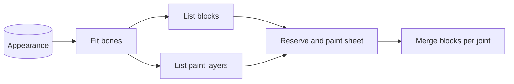

# Character Kit

A character is a set of rigid, textured blocks hung on the bones of a rig. The kit builds every character from an `Appearance` record, a body and its rig. No block ever bends, so characters never stretch or clip.

Rigs and bodies are content: authoring files in [content/rigs/](../content/rigs/) and [content/bodies/](../content/bodies/), which the bake writes to `assets/models/`. The parts that clip on or paint on, such as hair and equipment, are still code in [js/character/](../js/character/).

## From Appearance to Model

`CharacterModel.rebuild()` runs these steps every time the appearance changes.

1. [fitter.js](../js/kit/fitter.js) sizes the body's boxes from its variant and sliders, places each bone, and lists one body block for each bone with a box.
2. For a body whose surface is `outfit`, [kit.js](../js/character/kit.js) lists the clip-on blocks for the nose, ears, tusks, hair, beard and equipment, and [outfit.js](../js/character/outfit.js) lists, for each face of each body block, the painters to run in order: skin, then the face and hair, legs, feet, chest and hands. For a body whose surface is `placeholder`, [placeholder.js](../js/character/placeholder.js) paints every body block in the skin colour, shaded per bone.
3. [sheet.js](../js/character/sheet.js) reserves a texel area on one texture for each face of every block, then runs the painters into those areas.
4. [character-model.js](../js/character/character-model.js) merges each joint's blocks into one mesh with [BlockBuilder](../js/geometry/block-builder.js), creates one material from the sheet, and hangs the meshes on the joints. It creates a new set of joints when the rig changes.

The model then disposes the previous geometry, material and textures. A character has about 130 to 300 triangles. The model's `plan` holds the fit, the height in metres, the height of the face bone's box and each bone's rest position.

## Appearance and Catalogue

[catalogue.js](../js/character/catalogue.js) holds the options that are still code: the palettes, faces, noses, hair and beard styles, markings, equipment slots and items, and the archetypes that random villagers draw from. The bodies come from the baked assets through [Library](../js/kit/library.js). [appearance.js](../js/character/appearance.js) holds one character's choices and checks each change against the library and the catalogue.

| Field | Holds |
|---|---|
| `name` | Up to 20 letters, spaces, hyphens and apostrophes |
| `version` | The record's schema version, written by `toJSON()`. The current version is 2 |
| `body`, `variant` | A body id from the library, and one of that body's variants |
| `height`, `build` | Slider values from -1 to 1 |
| `skin` | A colour from the body's `skins` |
| `face`, `nose`, `hair`, `beard`, `markings` | Ids from the matching catalogue list |
| `eyes`, `hairColour` | Colours from `EYE_COLOURS` and `HAIR_COLOURS` |
| `equipment` | For each slot, `{ item, colour, trim }`, where each colour comes from the palette the item names |

`Appearance.normalise()` first migrates the record. A version 1 record, which named the body `race` and the variant `body`, moves to the version 2 fields, and a body or variant id that [content/migrations.js](../content/migrations.js) maps moves to its replacement. It then replaces any value that the library and the catalogue do not hold with a default. A saved character whose item or style no longer exists therefore loads with the default in its place.

Any body in the library is valid, but the creator offers only the playable bodies. The workbench shows the others, such as the wolf.

## Rigs and Bodies

A rig describes a kind of skeleton, and a body gives a rig its sizes. The diagram shows how the fitter combines them with the appearance.

### Rigs

A rig file in [content/rigs/](../content/rigs/) exports a `RIG`:

| Field | Holds |
|---|---|
| `id` | The rig's id |
| `boxes` | The names of the boxes a body must size, such as `head`, `torso`, `arm` and `leg` |
| `faceBone` | The bone that a face view frames |
| `motion` | `"biped"` for the animator's built-in walk, run and wave; left out for a rig that stands at rest |
| `bones` | The bones, in the order their faces pack the sheet |

Each bone has a `name`, a `parent` (another bone, or `root` at the feet), an optional `box`, a `pivot` and, with a box, a `centre`. The pivot places the joint in the parent's frame, and the centre places the bone's box in its own frame. Each coordinate is a number or a sum of box sizes in texels, such as `"torso.w/2 + arm.w/2"` or `"torso.h - 2"`, where `w`, `h` and `d` are a box's width, height and depth. An optional `rest` gives the bone's angles in radians about x, y and z. A bone `{ name, mirror }` copies another bone across x, so `armR` mirrors `armL`. The bake compiles each sum into a linear form, so the game parses no expressions.

[humanoid.js](../content/rigs/humanoid.js) is the rig of the five races and the ogre:

| Bone | Parent | Pivot | Box |
|---|---|---|---|
| `head` | `torso` | The top of the torso | Sits above the pivot |
| `torso` | `root` | The top of the legs | Stands above the pivot |
| `armL`, `armR` | `torso` | Beside the torso, 2 texels below its top | Hangs below, with its top 2 texels above the pivot |
| `legL`, `legR` | `root` | The hip, at the top of the leg | Hangs below the pivot |
| `cape` | `torso` | The back of the torso, at the shoulders | None; capes and cloaks hang here so they can swing back |

The bottom 5 rows of each arm are the hand, and the lower rows of each leg are the foot. Gloves, gauntlets, shoes and boots paint those rows. [quadruped.js](../content/rigs/quadruped.js) is the rig of the wolf: a body box along z, a head and snout at +z, four legs and a tail.

### Bodies

A body file in [content/bodies/](../content/bodies/) exports a `BODY`. Other modules in that folder, such as [humanoid-shared.js](../content/bodies/humanoid-shared.js), hold data that several bodies share.

| Field | Holds |
|---|---|
| `id`, `name`, `rig` | The body's id and name, and the rig it uses |
| `order`, `playable` | The body's place in lists, and whether the creator offers it |
| `surface` | `outfit` for the races, which wear parts and paint faces; `placeholder` for a body whose art is not made yet |
| `boxes` | Each of the rig's boxes as `[width, height, depth]` in texels |
| `variants` | Each variant's `id`, `name` and the change it makes to each box, such as the female variant's narrower torso |
| `sliders` | `build`, which adds a box change for each whole step of the slider, and `height`, which scales the whole character |
| `measures` | The collision `radius`, the `walk` and `run` speeds in metres a second, the `nameplate` height above the model and the camera `focus` height, in metres |
| `skins` | The skin colours on offer, as lower-case `#rrggbb` |
| `shades` | For a placeholder body, a shade factor for each bone's colour |
| `ears`, `hasTusks` | For an outfit body, the ear shape and whether the body has tusks |

Every head of an outfit body is 16 texels on a side, because the face and hair painters assume it. The humanoid bodies keep the legs at half the torso's width and its full depth, so every variant and build step changes the legs with the torso. A human male is 88 texels, or 1.8 metres, tall.

The bake checks every rig and body. It reports an unknown box or bone, a bone that is its own ancestor, a missing box size, a variant or build step that shrinks a box to nothing, a body that runs no faster than it walks, and an invalid colour.

## Blocks

A block is a plain object:

| Property | Holds |
|---|---|
| `joint` | The joint the block hangs on |
| `size` | `[width, height, depth]` in texels |
| `at` | The block's centre in texels, relative to the joint |
| `rotation` | Optional `[x, y, z]` angles in radians, turned about the block's centre |
| `faces` | Painters by face name: `front`, `back`, `left`, `right`, `top`, `bottom`, or `all` as the fallback |
| `part` | Set only on body blocks, to the name the outfit layers use |

A face that a painter leaves transparent stays see-through, because the character material discards texels with alpha below 0.5. The hood and the mail coif use this for their face openings, and the cloak for its ragged hem.

Held items use `holding(joint, grip)` in [kit.js](../js/character/kit.js), which places blocks along a weapon held forwards with its tip low. Poles such as staffs, spears and pitchforks stand upright in the hand instead.

## Texture Sheet and Painters

`Sheet` packs faces left to right in rows, 256 texels wide, and grows downwards as needed. It insets each face's UVs by a hundredth of a texel, so nearest sampling never reads a neighbouring face. A second raster of the same size holds the glow that the material's emissive map reads.

A painter is a function `(raster, area, random, glow)`. It draws inside `area` only, and draws into `glow` only when the texels should light themselves. [pixels.js](../js/art/pixels.js) holds the material painters, such as `cloth`, `leather`, `chain`, `plate`, `planks` and `stone`, and the drawing helpers `rows`, `columns`, `rect`, `dot` and `grit`. [face.js](../js/art/face.js) paints the 16 by 16 face, with its eyes, brows, mouth, beard and markings, and the hair on the other faces of the head.

Each character paints with a random generator seeded from its name and body id, so the same character always gets the same texels.

## Animation

[Animator](../js/character/animator.js) poses a rig whose `motion` is `biped`, and leaves any other rig at its rest angles. It turns joints each frame and never moves them, except to bob the torso above its rest position. It blends from idle to walking at 2.4 metres a second and to running at 5.2: the legs and arms swing in opposite phase, the torso bobs and leans, the head looks around when standing, and the cape swings back with speed. Held items change the arms' rest angles, and `wave()` raises the right arm for 2.2 seconds.

## Adding Content

Each change below ends with `npm test`. The character model test builds every option for every playable body and variant and fails on a vertex that is not a number, a UV off the sheet, more than 1,200 triangles or a sheet taller than 512 texels.

### A Hair Style

1. Add `{ id, name }` to `HAIR_STYLES` in [catalogue.js](../js/character/catalogue.js).
2. Add a case to `addHair` in [kit.js](../js/character/kit.js) for any blocks the style adds, such as a tail or a crest, on the `head` joint.
3. When the style changes the hair painted on the head itself, add a case to `hair` in [face.js](../js/art/face.js).

### An Equipment Item

1. Add the item to its slot's list in `EQUIPMENT`, with its `primary` and `trim` palettes and default colours.
2. When it paints the body, add a case to the slot's function in [outfit.js](../js/character/outfit.js), such as `paintChest`.
3. When it adds blocks, add a case to the slot's function in [kit.js](../js/character/kit.js), such as `addHeadgear`.
4. When a held item needs a different arm pose, extend `poseArms` in [animator.js](../js/character/animator.js).

### A Race

1. Add a body file to [content/bodies/](../content/bodies/) on the `humanoid` rig, with `surface: "outfit"`, `playable: true`, a 16-texel head, its box sizes, its `ears` shape, its `skins`, and `hasTusks` if it has them. Use the variants, sliders and measures in [humanoid-shared.js](../content/bodies/humanoid-shared.js) unless the race needs its own.
2. For a new ear shape, add a case to `addFeatures` in [kit.js](../js/character/kit.js) and the shape to `EARS` in [tools/bake/models.js](../tools/bake/models.js).
3. Add name syllables to [names.js](../js/character/names.js), or the race's random names use the human syllables.
4. Run `npm run bake`, check the race in the [workbench](workbench.md), then run `npm run bake -- --accept`.

### A Creature

1. Add a rig to [content/rigs/](../content/rigs/), or use an existing one.
2. Add a body file on that rig with `surface: "placeholder"` and `playable: false`.
3. Run `npm run bake` and open the body in the [workbench](workbench.md). Turn on "Bones and boxes" to check the pivots and boxes.

A new creature needs no change under `js/`.
