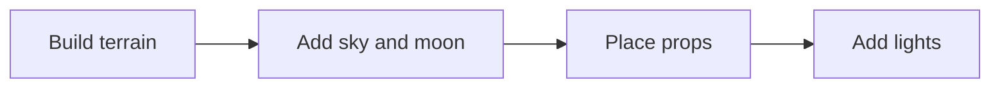

# World

[World](../js/world/world.js) builds one zone, the village of Hearthmere: tile terrain, block-built props, water, sky, lights and the collision that actors move against. Everything in the zone except the characters shares one material and one texture array.

## Building a Zone

The `World` constructor builds the zone in a fixed order, because each step needs the one before.

1. [Terrain](../js/world/terrain.js) computes every tile's height and type, then builds one mesh. [Water](../js/world/water.js) lays a plane just below the water level.
2. The sky is a sphere coloured from the horizon to the zenith, with a square moon, and follows the camera.
3. `addVillage`, `addChapelGrounds` and `addWilds` call the prop functions in [props.js](../js/world/props.js). Each prop writes blocks into one shared `BlockBuilder` and returns its collider, and the lit ones return light spots. The village layout is written in code, as coordinates in `world.js`.
4. A moonlight with shadows, a hemisphere light and one warm point light per light spot light the zone.

## Terrain

The zone is a grid of 96 by 96 tiles, each one metre square. `Terrain.shape()` combines rolling noise, walls of high ground at the edge, a sunken lake and a flat village, and each tile's height is that shape rounded to the nearest quarter-metre step.

`classify()` then gives each tile a type, which picks its top texture:

| Type | Where |
|---|---|
| `mud` | Under water and along the paths outside the village |
| `cobble` | In the village square and on the paths near it |
| `sand` | Low tiles near water |
| `stone`, `darkStone` | Tiles 4 metres high or more |
| `grass`, `moss` | Everywhere else, by noise |

Where a tile stands above a neighbour, the mesh adds a side face down to the neighbour's height: earth for a drop of up to 1.5 metres, and dark stone for a taller drop or for a tile 4 metres high or more. `heightAt(x, z)` returns the height of the tile under a point, so the ground is flat across each tile.

## World Textures

[world-textures.js](../js/world/world-textures.js) paints each texture into one layer of a texture array, 32 by 32 texels at 16 texels a metre. The layers are grass, moss, mud, cobble, earth, sand, stone, dark stone, grave stone, plaster, timber, planks, old planks, slate, thatch, bark, needles, leaves, iron, sacking, banner cloth and glow.

The world material in [materials.js](../js/engine/materials.js) reads the layer named by each vertex's `layer` attribute. Faces on the `glow` layer light themselves, which makes windows and lamps glow without a light of their own.

## Props

A prop is a function that writes blocks into a `BlockBuilder` and returns what the world needs to know about it:

| Return | Used for |
|---|---|
| `{ x, z, radius }` or `{ collider }` | A circle or a turned box that blocks movement |
| `{ lights }` or `{ light }` | Points where the world adds a warm point light |

`Props.block(builder, size, at, faces, rotation)` adds one block in metres. `faces` is a texture name for every face, or a map from face names to texture names with `all` as the fallback; a face mapped to `null` is left out. Inside a prop, the local `put` function returned by `placed()` adds blocks in the prop's own frame, turned about y and moved to the prop's position.

`stepRoof()` builds a roof from slabs a quarter-metre high, each stepped in from the one below, and fills the gable with wall blocks under them.

## Collision and Movement

`World.resolveStep(from, to, radius)` pushes a moving circle out of every circle and box collider, twice over, then checks the tile it lands on. The step is refused when that tile is under water, outside the zone, or more than half a metre above the tile the actor stands on. An actor eases its height towards the tile under it, so a quarter-metre step reads as a short climb.

## Lighting

| Light | Purpose |
|---|---|
| Hemisphere | Cold sky from above and warm earth from below |
| Directional moonlight | The main light; casts shadows in a 52-metre square around the player |
| Point lights | One at each lit window, lamp post and the chapel door |
| Glow texels | Window panes, lamps and lanterns light themselves |
| Fog | Fades the zone into the horizon colour between 14 and 58 metres |

## Adding to the World

To add a prop, write a function in [props.js](../js/world/props.js) that builds with `placed()` and returns its collider, then call it from `World`. To add a world texture, add a name and a painter to `LAYERS` in [world-textures.js](../js/world/world-textures.js). To add a tile type, give it a texture of the same name and a rule in `Terrain.classify()`.

Run `npm test` and `node js-tests/browser/run.js --covers world` after a change. The terrain tests check the steps, the flat village and the collision rules.
